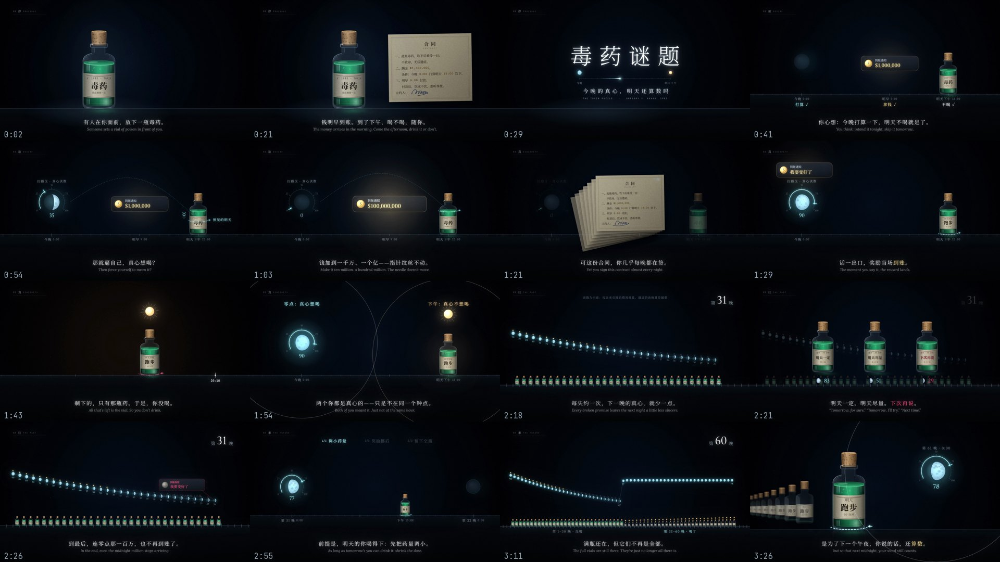

# 毒药谜题 · THE TOXIN PUZZLE

**今晚的真心，明天还算数吗**

一条 3 分 37 秒、没有人声的知识短片（16:9，1920×1080，30fps）。观众读底部一行字幕，同时看屏上把这句话演出来。
画面、动画和声音全部由代码逐帧生成：Canvas 2D 画每一帧，Playwright 逐帧截图，ffmpeg 压成视频；音效由 numpy 合成，没有用任何采样。



成片预览：[`毒药谜题_720p.mp4`](毒药谜题_720p.mp4)（1280×720，14MB）。1080p 母版由 `render.py` + `audio.py` 重新渲出（约 30 分钟）。

## 讲的是什么

1983 年，哲学家 Gregory Kavka 出了一道题：一位亿万富翁在你面前放一小瓶毒药，喝下会难受一整天，但不危及生命，也没有后遗症。
只要你在**今晚零点打算明天下午喝下它**，他明早就付你一百万美元。钱到账以后，喝不喝随你。

听起来是白送的钱，可是一个清醒理性的人拿不到。你很清楚，钱一到账，喝下去就只剩难受，所以你没法真心打算去喝。打算不是靠"想要"就能有的。

这条片子把这道题接到每个人都熟悉的事情上：**"明天开始"**。

- 零点许下"明天开始跑步"的那一刻，"我要变好了"的满足感当场就到账了。这就是零点的那一百万。
- 到了第二天下午，奖励早就领过了，剩下的只有那瓶药，于是没喝。两个你都是真心的，只是不在同一个钟点。
- 一次次失约之后，扫描仪靠你的过去来预见你的明天，许诺从"明天一定"变成"明天尽量"，再变成"下次再说"。
- 可题里只有一个午夜，生活里午夜每天都来。所以明天喝下去，就有了一个真理由：下一个午夜会看见这只空瓶。

全片四章，对应四个词：**01 欲 · 02 真 · 03 往 · 04 来**（欲望、真心、过去、未来）。

## 设计

**一个形象用到底**：一小瓶毒药。它是题里的毒药，在第 02 章变成"明天开始跑步"，在第 03 章变成一排没喝的满瓶，在第 04 章变成一瓶比一瓶高的空瓶。

**一个世界**：一条时间尺，今晚 0:00 → 明早 9:00 → 明天下午 15:00，一天接一天往右延伸。镜头只在这条尺子上推、拉、平移，过去在左，未来在右。
开场那瓶药就站在第 1 晚 15:00 的刻度上，只是镜头推得太近，看不出是一条尺子。

**一把尺子**：扫描仪的"真心读数"。它读的是药瓶上那条冰蓝色虚线"预见的明天"，也就是你预见自己会喝到哪。读数同时画成零点那轮月亮的亮面：
一个月失约，三十轮月亮一轮比一轮细、一轮比一轮低，自己连成一条往下走的折线；兑现以后又盈回来。

| 颜色 | 全片只有一个意思 |
|---|---|
| 毒绿 | 药液：明天要付出的那份苦 |
| 冰蓝 | 真心：打算、预见、读数、月光 |
| 金 | 奖励：钱、"我要变好了" |
| 玫红 | 失约："下次再说"、到账失败 |

**三次"哦——"**：两个你都是真心的，只是不在同一个钟点（第 22 镜）；题里只有一个午夜，生活里午夜每天都来（第 32 镜）；满瓶还在，但它们不再是全部（第 39 镜）。

**回场**：开场那张合同在第 02 章又签了一沓；"理性的人拿不到这一百万"在第 03 章变成"你成了题里的那个人"；最后一镜回到第一镜的构图，只多了身后那六十个日子。

完整的逐句分镜在 [`storyboard.md`](storyboard.md)，事实和出处在 [`facts.md`](facts.md)。

## 技术

- **玻璃药瓶**分两遍画。实心的部分（药液、软木塞、标签）画在不吃辉光的底层；玻璃的轮廓光、高光、液面亮边、药液自己的光画在光层，再整体加辉光。
  液面在屏幕上始终保持水平，标签上的字按圆柱面压缩。桌面上的倒影是先把瓶子翻过来画进一张小画布，再用渐变蒙版抹淡。
- **每一帧只由时间 t 决定**，没有跨帧状态，所以可以只渲一段、乱序截帧。`render.py --det` 自检通过：同一帧渲两次逐字节一致。
- **读数是算出来的**：r 从 0.90 起，每过一晚 r ← 0.96·r + 0.04·x（兑现 x = 1，失约 x = 0）；药量 d 的读数是 r^d。
  屏上每个数字、每轮月亮的亮面都是查这张表，第 3、15、29 晚并排的 83 / 51 / 29 也来自同一张表（见 `world.js`，模型是示意）。
- **摄影机**：缩放在对数空间里插值，焦点按 1/缩放 走，所以从一个钟点拉到六十天、再推回一瓶药，都不会先平移再猛冲。
- **声音**：低频长音垫底，每章一记和弦；玻璃磕桌、翻纸、打字机、签名、到账提示音、扫描、绷紧和弹回、钟摆、吞咽等 23 种音效全部合成（`engine/audio.py`）。
  画面里每个事件用 `fr.sfx(时刻, 名字)` 登记，导出成事件表再合成。

## 自己渲一遍

```bash
pip install playwright numpy scipy Pillow
python engine/get_fonts.py                       # 下载开源字体（SIL OFL）
python engine/render.py films/toxin --serve      # 浏览器预览 http://127.0.0.1:8765/?play
python engine/render.py films/toxin --sheet 16   # 全片均匀 16 帧拼一张
python engine/render.py films/toxin --jobs 4     # 全片 → renders/raw.mp4
python engine/render.py films/toxin --events && python engine/audio.py films/toxin   # 合成声音 → renders/final.mp4
```

需要本机的 Google Chrome 和 ffmpeg；没有 Chrome 时可以用 `VK_CHROME=/path/to/chromium` 指定一个 Chromium。

## 发布文案

**标题**：Vibe知识大赏 |《毒药谜题》

**正文**：有人在你面前，放下一瓶毒药。喝下去，难受一整天；不会死，也不留后遗症。他出一百万美元，不是让你喝——只要今晚零点，你打算明天下午喝下它。钱明早到账。到了下午，喝不喝，随你。

**话题**：#vibe知识大赏 #毒药谜题 #哲学 #心理学 #拖延 #自律

## 出处

- Gregory S. Kavka, “The Toxin Puzzle,” *Analysis* 43(1): 33–36, 1983
- David Gauthier, “Rethinking the Toxin Puzzle,” in *Rational Commitment and Social Justice: Essays for Gregory Kavka*, Cambridge University Press, 1998
- Michael E. Bratman, “Toxin, Temptation, and the Stability of Intention,” 同上, 1998
- George Ainslie, *Breakdown of Will*, Cambridge University Press, 2001

9:00 / 15:00 两个钟点、真心读数、月相和药量都是示意，片中已写明。

渲染引擎取自 [HeyChengC/vibe-knowledge-film](https://github.com/HeyChengC/vibe-knowledge-film)（MIT），见 [`../../engine/README.md`](../../engine/README.md)。
